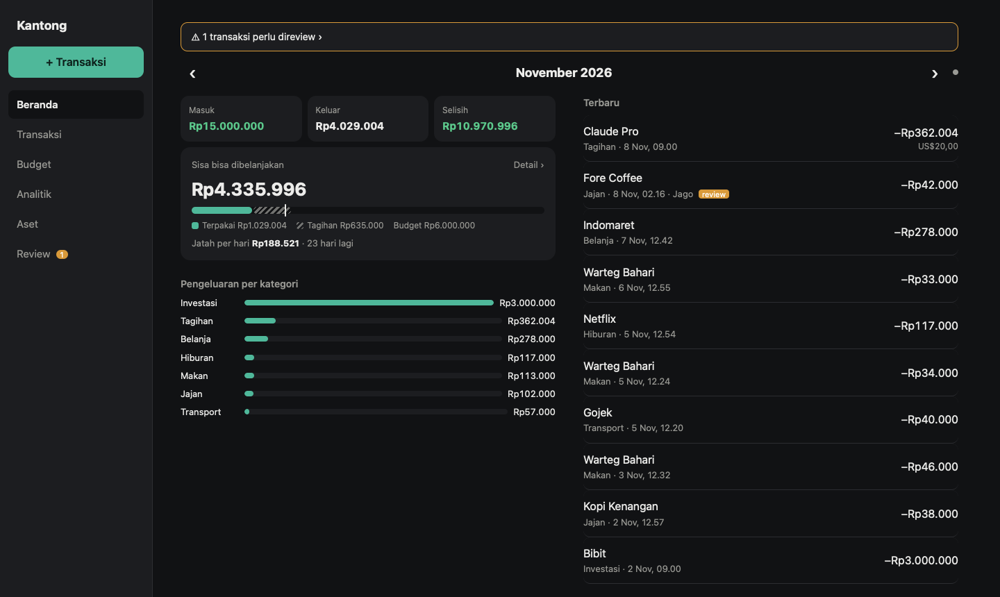
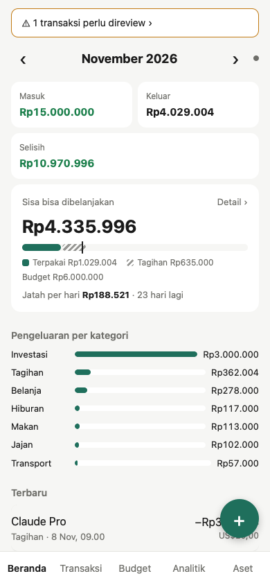
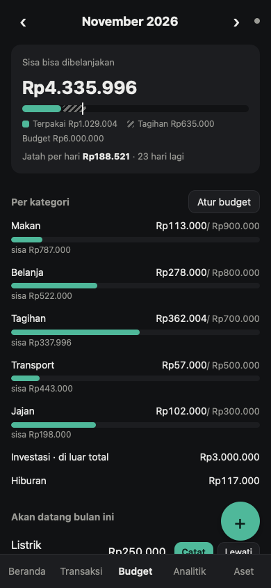
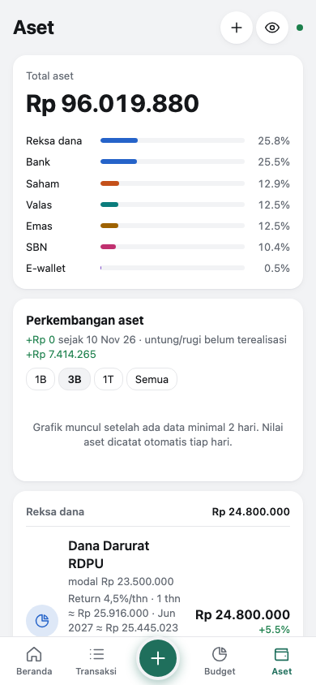
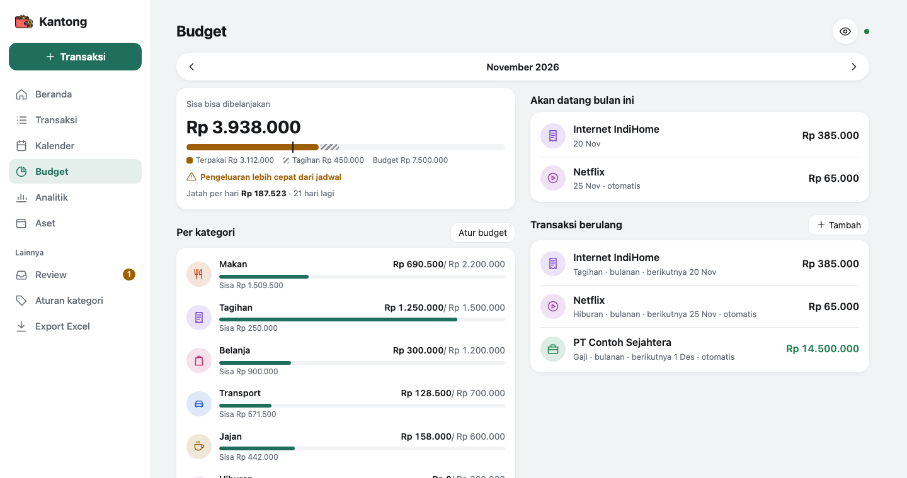
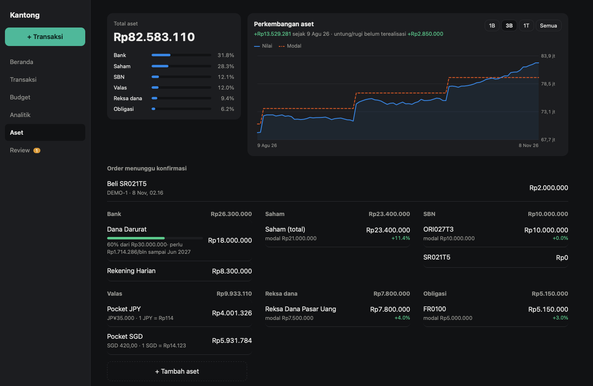
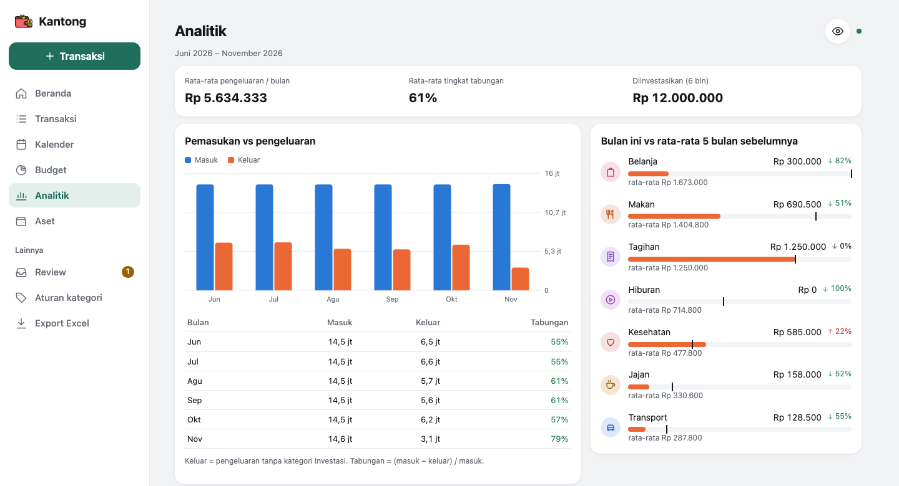

# Kantong

Money manager pribadi yang self-hosted. Notifikasi transaksi dari email bank/broker dibaca otomatis oleh agent, disimpan lewat API, dan langsung muncul realtime di PWA.

Satu binary Go (API + SQLite + SSE + PWA Svelte yang di-embed), image Docker ±22 MB, RAM idle ±3 MB.



<p align="center">
  
  
  
</p>

> Semua screenshot pakai data contoh.

## Fitur

- **Transaksi**: masuk / keluar / transfer dengan kategori. Bisa dicari di semua bulan dan di-export ke CSV.
- **Multi-currency**: transaksi dalam USD/SGD/JPY/... disimpan nominal aslinya, lalu dikonversi ke IDR pakai kurs hari itu ([frankfurter.dev](https://frankfurter.dev), data ECB).
- **Budget bulanan**: total dan per kategori, berlaku terus ke bulan berikutnya sampai diubah. Ada sisa bisa dibelanjakan (dikurangi tagihan yang akan datang), jatah per hari, dan penanda posisi bulan.
- **Transaksi berulang**: gaji, langganan, cicilan, parkir kantor. Mingguan dengan pilihan hari (mis. Sen–Jum), bulanan dengan pilihan bulan, atau tahunan. Bisa dicatat otomatis atau manual (Catat / Lewati).
- **Aset & portofolio**: rekening, valas, saham (total), obligasi, SBN, reksa dana, emas, kripto. Ada total kekayaan dalam IDR, alokasi per jenis, untung/rugi vs modal, target tabungan, proyeksi return obligasi/SBN (kupon tiap bulan/3/6/12 bulan atau tanpa kupon, bersih pajak 10%) sampai jatuh tempo, dan proyeksi return reksa dana.
- **Order investasi dari email**: konfirmasi pembelian dicatat *pending*, lalu email berhasil/gagal menyelesaikannya dan meng-update saldo aset.
- **Kalender**: pengeluaran per tanggal dengan warna sesuai besarnya, tagihan berulang yang akan datang, jumlah hari tanpa belanja, dan daftar transaksi per hari.
- **Analitik**: 6 bulan masuk vs keluar, tingkat tabungan, dan kategori bulan ini dibanding rata-ratanya.
- **Review & aturan**: transaksi hasil parsing email yang kurang yakin ditandai untuk dicek sekali tap. Koreksi kategori bisa disimpan jadi aturan ("selalu kategorikan Gojek sebagai Transport"), dan email berikutnya dari merchant itu langsung masuk dengan kategori yang benar.
- **Notifikasi Telegram**: setiap transaksi baru dari email dikirim ke Telegram, misalnya `Keluar Rp25.000 · Jajan · Indomaret (perlu review)`.
- **Backup harian**: salinan database tiap jam 03:00 WIB, 14 hari terakhir disimpan.
- **Realtime**: transaksi baru dari agent langsung muncul di semua perangkat (SSE).
- **Tampilan**: layout terpisah untuk desktop dan mobile, mengikuti dark mode sistem, dan bisa di-install sebagai PWA.

| Budget | Aset |
|---|---|
|  |  |



## Cara kerja

```
Email bank/broker ──▶ mailbox (IMAP, read-only)
                            │  cron tiap 10 menit
                            ▼
                     Agent (LLM) ── parsing ──▶ POST /api/transactions, /api/orders
                                                        │
                                              Go API + SQLite (WAL)
                                                        │ SSE
                                                        ▼
                                                PWA (desktop & HP)
```

- Tahap fetch berjalan tanpa LLM. Email yang `Message-ID`-nya sudah tercatat dilewati lewat `POST /api/source-refs/check`, jadi LLM cuma dibangunkan kalau ada email baru.
- `source_ref` (Message-ID) bersifat unik, sehingga email yang sama nggak pernah tercatat dua kali.
- Transaksi dengan `confidence < 0.7` otomatis masuk antrian Review.

Skill agent-nya ([Hermes](https://github.com/NousResearch/hermes-agent)) ada di [`hermes/`](hermes). Cara menyambungkan email bank ke Hermes, dari bikin app password sampai cron, ada di **[docs/hermes-email.md](docs/hermes-email.md)**.

## Jalanin

```sh
cp .env.example .env        # isi tiap secret: openssl rand -hex 32
docker compose up -d --build
curl http://127.0.0.1:8080/healthz   # -> ok
```

| Env | Default | Keterangan |
|---|---|---|
| `API_TOKEN` | – | Bearer token untuk agent/script |
| `APP_PASSWORD` | – | Password login PWA |
| `SESSION_SECRET` | – | Minimal 32 karakter, untuk tanda tangan cookie sesi |
| `HOST_BIND` / `HOST_PORT` | `127.0.0.1` / `8080` | Alamat & port yang di-publish compose |
| `COOKIE_SECURE` | `true` | Set `false` hanya kalau diakses lewat HTTP biasa (tanpa HTTPS, PWA nggak bisa di-install) |
| `TELEGRAM_BOT_TOKEN` / `TELEGRAM_CHAT_ID` | – | Notifikasi transaksi dari email; kosong = mati |
| `FX_URL` | `https://api.frankfurter.dev` | Sumber kurs |
| `DB_PATH` / `PORT` | `/data/money.db` / `8080` | Di dalam container |

Perubahan `.env` baru terpakai setelah `docker compose up -d --force-recreate`.

### Dev

```sh
cd web && npm ci && npm run build && cd ..   # build PWA ke web/dist (di-embed)
set -a; . ./.env; set +a
DB_PATH=./money.db go run .
go test ./...
cd web && npm run dev                        # Vite + proxy /api ke :8080
```

## API

Semua endpoint `/api/*` butuh `Authorization: Bearer $API_TOKEN` atau cookie sesi dari `POST /api/login`.

| Endpoint | Fungsi |
|---|---|
| `GET/POST /api/transactions`, `PATCH/DELETE /api/transactions/{id}` | Transaksi (`?month=YYYY-MM` atau `?q=cari`) |
| `POST /api/source-refs/check` | Message-ID mana yang belum tercatat |
| `GET /api/summary?month=` | Total masuk/keluar per kategori |
| `GET /api/categories` | Kategori |
| `GET/POST /api/rules`, `DELETE /api/rules/{id}` | Aturan merchant → kategori. Dicek otomatis untuk setiap transaksi `source=email` (cocok kalau merchant mengandung `pattern`, tanpa beda huruf besar/kecil; pattern terpanjang menang). POST dengan pattern yang sama menimpa aturan lama |
| `GET/PUT /api/budget` | Budget bulan ini vs pengeluaran + tagihan mendatang |
| `GET/POST/PATCH/DELETE /api/recurring`, `POST /api/recurring/{id}/advance` | Transaksi berulang (`?skip=1` untuk lewati) |
| `GET/POST/PATCH/DELETE /api/assets`, `GET /api/assets/history` | Aset, total kekayaan, riwayat harian |
| `POST /api/orders`, `PATCH /api/orders/{order_ref}` | Order investasi pending → success/failed |
| `GET /api/fx?currency=USD` | Kurs ke IDR |
| `GET /api/export.csv` | Semua transaksi |
| `GET /api/events` | Stream SSE |

```sh
API=http://127.0.0.1:8080; AUTH="Authorization: Bearer $API_TOKEN"

# transaksi dari email (201; 409 + id kalau source_ref sudah ada)
curl -s -H "$AUTH" -X POST $API/api/transactions -d '{
  "occurred_at":"2026-11-07T12:30:00+07:00","amount":25000,"type":"out","category":"Jajan",
  "merchant":"Indomaret","account":"BCA","source":"email","source_ref":"<abc@bank>","confidence":0.92}'

# tagihan USD: amount IDR dihitung dari kurs hari itu kalau dikosongkan
curl -s -H "$AUTH" -X POST $API/api/transactions -d '{
  "type":"out","category":"Tagihan","merchant":"Claude","source":"manual","currency":"USD","orig_amount":20}'

# order SBN: pending dulu, lalu diselesaikan dari email berikutnya
curl -s -H "$AUTH" -X POST $API/api/orders -d '{"asset":"ORI027T3","kind":"sbn","side":"buy","amount":1000000,"order_ref":"TRX-123"}'
curl -s -H "$AUTH" -X PATCH $API/api/orders/TRX-123 -d '{"status":"success"}'

curl -N -H "$AUTH" $API/api/events   # biarin kebuka, lihat event masuk
```

## Backup

App membuat backup sendiri tiap hari jam 03:00 WIB (dan saat start kalau backup hari itu belum ada) ke `/data/backups/money-YYYY-MM-DD.db` di volume, dengan 14 file terakhir disimpan. Backup dibuat pakai `VACUUM INTO`, jadi app nggak perlu di-stop.

Salin ke Mac (jalankan dari Mac):

```sh
mkdir -p ~/Backups/kantong
ssh user@server "docker cp kantong-money-1:/data/backups -" | tar -x -C ~/Backups/kantong
```

Supaya berkala, tambahkan baris itu ke `crontab -e` di Mac, misalnya `0 9 * * * ssh ... | tar ...`.

Restore (di server; ganti tanggalnya):

```sh
docker compose stop
docker run --rm -v kantong_money-data:/data alpine sh -c \
  'cp /data/backups/money-2026-11-08.db /data/money.db && rm -f /data/money.db-wal /data/money.db-shm && chown 65532:65532 /data/money.db'
docker compose start
```
