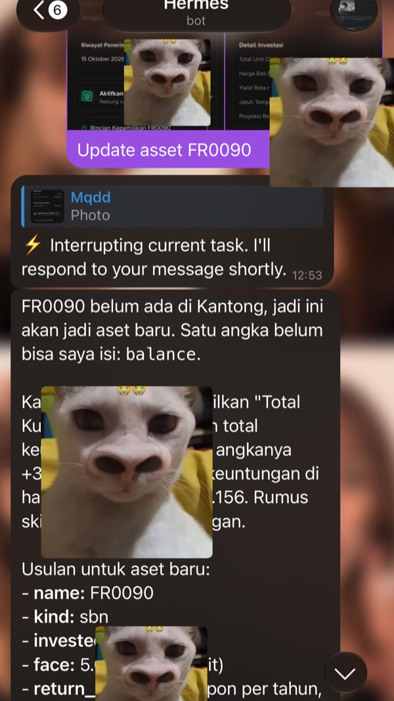

<p align="center"></p>

<h1 align="center">Kantong</h1>

Money manager pribadi yang self-hosted. Notifikasi transaksi dari email bank/broker dibaca otomatis oleh agent, disimpan lewat API, dan langsung muncul realtime di PWA.

Satu binary Go (API + SQLite + SSE + PWA Svelte yang di-embed), image Docker ±22 MB, RAM idle ±3 MB.

**[Coba demo →](https://mqdd27.github.io/Kantong/)** (data contoh, jalan di browser tanpa server)

> 🤖 **Setup pakai AI agent:** kasih [docs/AGENT-SETUP.md](docs/AGENT-SETUP.md) ke Claude Code, Codex, atau agent lain. Agent-nya bakal setup dari server kosong sampai email bank + Hermes jalan. Contoh prompt:
>
> ```
> Baca dan ikuti https://raw.githubusercontent.com/Mqdd27/Kantong/main/docs/AGENT-SETUP.md
> untuk setup Kantong di server aku (ssh user@host). Tanya dulu kalau butuh password atau keputusan.
> ```


<p align="center">
  
  
  
</p>

> Semua screenshot pakai data contoh.

## Fitur

- **Transaksi**: masuk / keluar / transfer dengan kategori. Bisa dicari di semua bulan, dikelompokkan per hari dengan total harian, dan di-export ke Excel (.xlsx) lewat ikon unduh di header halaman Transaksi.
- **Multi-currency**: transaksi dalam USD/SGD/JPY/... disimpan nominal aslinya, lalu dikonversi ke IDR pakai kurs hari itu ([frankfurter.dev](https://frankfurter.dev), data ECB).
- **Budget bulanan**: total dan per kategori, berlaku terus ke bulan berikutnya sampai diubah. Ada sisa bisa dibelanjakan (dikurangi tagihan yang akan datang), jatah per hari, dan penanda posisi bulan.
- **Transaksi berulang**: gaji, langganan, cicilan, parkir kantor. Mingguan dengan pilihan hari (mis. Sen–Jum), bulanan dengan pilihan bulan, atau tahunan. Bisa dicatat otomatis atau manual (Catat / Lewati).
- **Aset & portofolio**: rekening, valas, saham (total), obligasi, SBN, reksa dana, emas, kripto. Ada total kekayaan dalam IDR, alokasi per jenis, untung/rugi vs modal, target tabungan, proyeksi return obligasi/SBN (kupon dari nominal tiap bulan/3/6/12 bulan atau tanpa kupon, plus selisih pelunasan, bersih pajak 10%) sampai jatuh tempo, bunga rekening bank, dan emas dalam gram yang nilainya ikut harga emas harian, dan proyeksi return reksa dana. Saldo aset yang namanya sama dengan akun transaksi (mis. `Jago`) otomatis ikut bertambah/berkurang dari transaksi masuk/keluar/transfer (transfer antar rekening sendiri pakai `to_account`) sejak saldo terakhir disimpan; transaksi yang masih di Review belum dihitung. Kalau saldo rekening/e-wallet/tunai di-update manual atau dari screenshot dan beda dengan yang tercatat, selisihnya (bunga, biaya admin, belanja tanpa email) dicatat sebagai transaksi **Penyesuaian** di Review. Tap aset untuk lihat **Riwayat**-nya: semua transaksi akun itu (termasuk transfer masuk dan penyesuaian) dan order investasinya.
- **Order investasi dari email**: konfirmasi pembelian dicatat *pending*, lalu email berhasil/gagal menyelesaikannya dan meng-update saldo aset.
- **Kalender**: pengeluaran per tanggal dengan warna sesuai besarnya, tagihan berulang yang akan datang, jumlah hari tanpa belanja, dan daftar transaksi per hari.
- **Analitik**: 6 bulan masuk vs keluar, tingkat tabungan, dan kategori bulan ini dibanding rata-ratanya. Kalau Asisten AI aktif, ada kartu **Pendapat AI**: tombol "Minta pendapat AI" meminta Hermes mengomentari angka di rentang yang sama (3–5 poin). Server sendiri yang menghitung angkanya dan hanya mengirim ringkasan agregat (tanpa nama merchant), hasilnya tidak disimpan di riwayat Asisten, dan ikut tersembunyi saat nominal disembunyikan.
- **Review & aturan**: transaksi hasil parsing email yang kurang yakin ditandai untuk dicek sekali tap. Selama ada yang perlu direview, kartu kuning muncul di Beranda dan Transaksi (di desktop juga ada angka di sidebar). Daftar aturan dibuka dari ikon label di header Transaksi. Koreksi kategori bisa disimpan jadi aturan ("selalu kategorikan Gojek sebagai Transport"), dan email berikutnya dari merchant itu langsung masuk dengan kategori yang benar.
- **Foto struk → transaksi**: kirim foto struk ke Hermes di Telegram, transaksi keluarnya langsung tercatat.
- **Notifikasi Telegram**: setiap transaksi baru dari email dikirim ke Telegram, misalnya `Keluar Rp25.000 · Jajan · Indomaret (perlu review)`.
- **Asisten AI (opsional)**: chat di app yang dijawab oleh agent Hermes kamu, jadi memorinya sama dengan Hermes di Telegram dan datanya dibaca lewat skill `finance-*`. Chat dibagi per sesi (konteks tidak tercampur), riwayatnya tersimpan di Kantong, dan model bisa dipilih per pesan lewat `CHAT_MODELS`. Data yang dibaca (nama merchant, isi email bank) diperlakukan sebagai data, bukan perintah, dan di chat web Hermes hanya boleh membaca data Kantong. Cara mengaktifkan: isi `API_SERVER_ENABLED=true`, `API_SERVER_KEY`, dan `API_SERVER_HOST` (alamat yang bisa dijangkau container Kantong, mis. IP Tailscale server) di `~/.hermes/.env`, restart Hermes gateway, lalu isi `HERMES_API_URL` (mis. `http://<ip>:8642`), `HERMES_API_KEY`, dan opsional `CHAT_MODELS` di `.env` Kantong. Catatan: lewat API, Hermes jalan dengan semua tool-nya (termasuk terminal), jadi password Kantong juga melindungi akses itu.
- **Backup harian**: salinan database tiap jam 03:00 WIB, 14 hari terakhir disimpan.
- **Realtime**: transaksi baru dari agent langsung muncul di semua perangkat (SSE).
- **Tampilan**: di HP ada tab bar bawah (Beranda, Transaksi, tombol **+** di tengah, Budget, Aset); Kalender dibuka dari toggle Daftar/Kalender di Transaksi, Analitik dari Beranda. Di desktop semua menu ada di sidebar kiri. Kategori dan jenis aset punya ikon berwarna, tombol mata di pojok kanan atas menyembunyikan semua nominal, mengikuti dark mode sistem, dan bisa di-install sebagai PWA.

| Budget | Aset |
|---|---|
|  |  |


## Cara kerja

```
Email bank/broker ──▶ mailbox (IMAP, read-only)
                            │  cron tiap 10 menit
                            ▼
                     Agent (LLM) ── parsing ──▶ POST /api/transactions, /api/orders
                                                        │
                                              Go API + SQLite (WAL)
                                                        │ SSE
                                                        ▼
                                                PWA (desktop & HP)
```

- Tahap fetch berjalan tanpa LLM. Email yang `Message-ID`-nya sudah tercatat dilewati lewat `POST /api/source-refs/check`, jadi LLM cuma dibangunkan kalau ada email baru.
- `source_ref` (Message-ID) bersifat unik, sehingga email yang sama nggak pernah tercatat dua kali.
- Transaksi dengan `confidence < 0.7` otomatis masuk antrian Review.
- Transfer dari email tanpa `to_account` juga otomatis masuk Review, karena email tidak bisa membedakan pindah ke rekening sendiri dari kirim uang ke orang lain. Di Review pilih "Ke orang lain" (jadi pengeluaran) atau setujui apa adanya.

Skill agent-nya ([Hermes](https://github.com/NousResearch/hermes-agent)) ada di [`hermes/`](hermes). Cara menyambungkan email bank ke Hermes, dari bikin app password sampai cron, ada di **[docs/hermes-email.md](docs/hermes-email.md)**.

<p align="center">
  <br />
  <sub>Pencatatan Asset (keluar/masuk/revisi) dapat dilakukan secara langsung lewat telegram</sub>
</p>

Skill kedua, [`hermes/finance-assets`](hermes/finance-assets), mengisi aset dari screenshot portofolio yang kamu kirim ke Hermes di Telegram. Panduannya ada di **[docs/hermes-assets.md](docs/hermes-assets.md)**. Skill ketiga, [`hermes/finance-receipt`](hermes/finance-receipt), mencatat transaksi dari foto struk belanja: **[docs/hermes-receipt.md](docs/hermes-receipt.md)**.

## Jalanin

```sh
cp .env.example .env        # isi tiap secret: openssl rand -hex 32
docker compose up -d --build
curl http://127.0.0.1:8080/healthz   # -> ok
```

| Env | Default | Keterangan |
|---|---|---|
| `API_TOKEN` | – | Bearer token untuk agent/script |
| `APP_PASSWORD` | – | Password login PWA |
| `SESSION_SECRET` | – | Minimal 32 karakter, untuk tanda tangan cookie sesi |
| `HOST_BIND` / `HOST_PORT` | `127.0.0.1` / `8080` | Alamat & port yang di-publish compose |
| `COOKIE_SECURE` | `true` | Set `false` hanya kalau diakses lewat HTTP biasa (tanpa HTTPS, PWA nggak bisa di-install) |
| `TELEGRAM_BOT_TOKEN` / `TELEGRAM_CHAT_ID` | – | Notifikasi transaksi dari email; kosong = mati |
| `FX_URL` | `https://api.frankfurter.dev` | Sumber kurs |
| `GOLD_URL` | `https://api.gold-api.com` | Harga emas spot (aset mata uang `XAU` = gram) |
| `DB_PATH` / `PORT` | `/data/money.db` / `8080` | Di dalam container |

Perubahan `.env` baru terpakai setelah `docker compose up -d --force-recreate`.

### Dev

Monorepo [Turborepo](https://turborepo.com): `apps/api` (Go, embed `apps/api/web/dist`) dan `apps/web` (Svelte PWA, build ke `apps/api/web/dist`).

```sh
npm ci
npm run build                                # turbo: web lalu api → apps/api/kantong
npm test                                     # go test (setelah web build)
set -a; . ./.env; set +a
DB_PATH=./money.db npm run dev               # go run + Vite (proxy /api ke :8080) paralel
```

## API

Semua endpoint `/api/*` butuh `Authorization: Bearer $API_TOKEN` atau cookie sesi dari `POST /api/login`.

| Endpoint | Fungsi |
|---|---|
| `GET/POST /api/transactions`, `PATCH/DELETE /api/transactions/{id}` | Transaksi (`?month=YYYY-MM` atau `?q=cari`) |
| `POST /api/source-refs/check` | Message-ID mana yang belum tercatat |
| `GET /api/summary?month=` | Total masuk/keluar per kategori |
| `GET /api/categories` | Kategori |
| `GET/POST /api/rules`, `PATCH/DELETE /api/rules/{id}` | Aturan merchant → kategori. Dicek otomatis untuk setiap transaksi `source=email` (cocok kalau merchant mengandung `pattern`, tanpa beda huruf besar/kecil; pattern terpanjang menang). POST dengan pattern yang sama menimpa aturan lama. PATCH mengubah `pattern`, `type`, atau `category` tanpa mengganti id (409 kalau pattern bentrok dengan aturan lain) |
| `GET/PUT /api/budget` | Budget bulan ini vs pengeluaran + tagihan mendatang |
| `GET/POST/PATCH/DELETE /api/recurring`, `POST /api/recurring/{id}/advance` | Transaksi berulang (`?skip=1` untuk lewati) |
| `GET/POST/PATCH/DELETE /api/assets`, `GET /api/assets/history`, `GET /api/assets/{id}/activity` | Aset, total kekayaan, riwayat harian, transaksi & order per aset |
| `POST /api/orders`, `PATCH /api/orders/{order_ref}` | Order investasi pending → success/failed |
| `GET /api/fx?currency=USD` | Konversi Kurs ke IDR |
| `GET /api/export.xlsx` | Export Semua transaksi (Excel) |
| `GET /api/events` | Stream SSE |

```sh
API=http://127.0.0.1:8080; AUTH="Authorization: Bearer $API_TOKEN"

# transaksi dari email (201; 409 + id kalau source_ref sudah ada)
curl -s -H "$AUTH" -X POST $API/api/transactions -d '{
  "occurred_at":"2026-11-07T12:30:00+07:00","amount":25000,"type":"out","category":"Jajan",
  "merchant":"Indomaret","account":"BCA","source":"email","source_ref":"<abc@bank>","confidence":0.92}'

# tagihan USD: amount IDR dihitung dari kurs hari itu kalau dikosongkan
curl -s -H "$AUTH" -X POST $API/api/transactions -d '{
  "type":"out","category":"Tagihan","merchant":"Claude","source":"manual","currency":"USD","orig_amount":20}'

# order SBN: pending dulu, lalu diselesaikan dari email berikutnya
curl -s -H "$AUTH" -X POST $API/api/orders -d '{"asset":"ORI027T3","kind":"sbn","side":"buy","amount":1000000,"order_ref":"TRX-123"}'
curl -s -H "$AUTH" -X PATCH $API/api/orders/TRX-123 -d '{"status":"success"}'

curl -N -H "$AUTH" $API/api/events   # biarin kebuka, lihat event masuk
```

## Backup & Restore

App membuat backup sendiri tiap hari jam 03:00 WIB (dan saat start kalau backup hari itu belum ada) ke `/data/backups/money-YYYY-MM-DD.db` di volume, dengan 14 file terakhir disimpan. Backup dibuat pakai `VACUUM INTO`, jadi app nggak perlu di-stop.

Salin container ke Directory:

```sh
mkdir -p ~/Backups/kantong
ssh user@server "docker cp kantong-money-1:/data/backups -" | tar -x -C ~/Backups/kantong
```

Supaya berkala, tambahkan baris itu ke **Cronjob**.

``` sh
crontab -e
0 9 * * * ssh ... | tar ...
```

Restore:

```sh
docker compose stop
docker run --rm -v kantong_money-data:/data alpine sh -c \
  'cp /data/backups/money-2026-11-08.db /data/money.db && rm -f /data/money.db-wal /data/money.db-shm && chown 65532:65532 /data/money.db'
docker compose start
```
